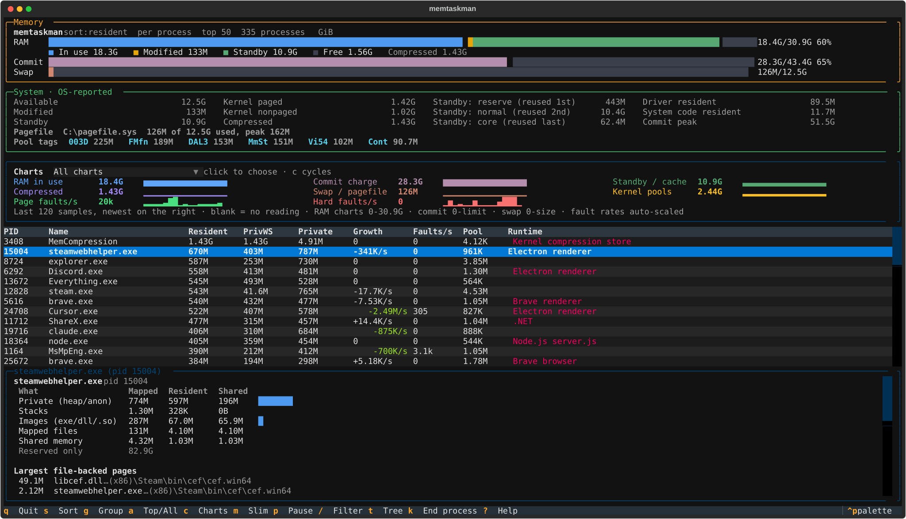
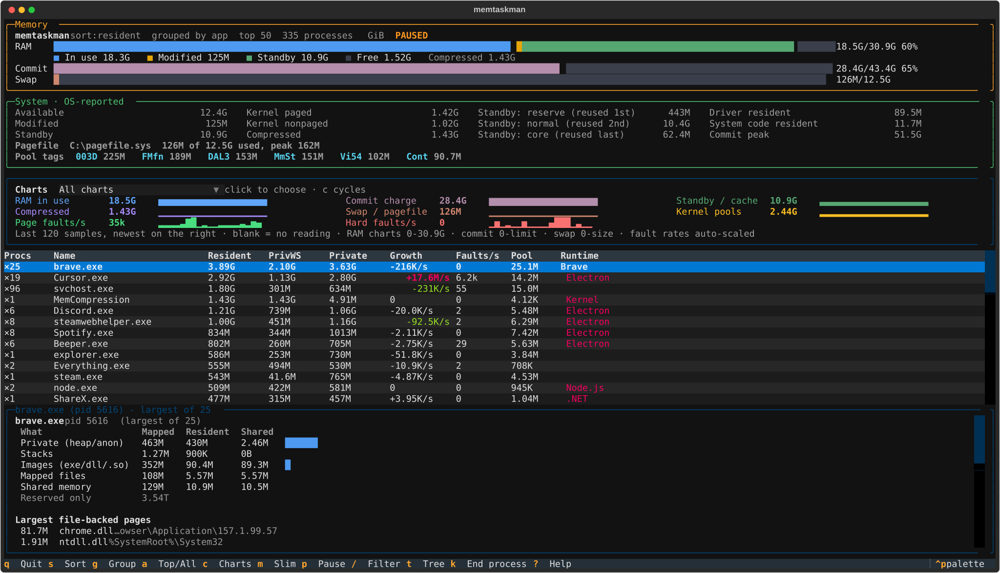
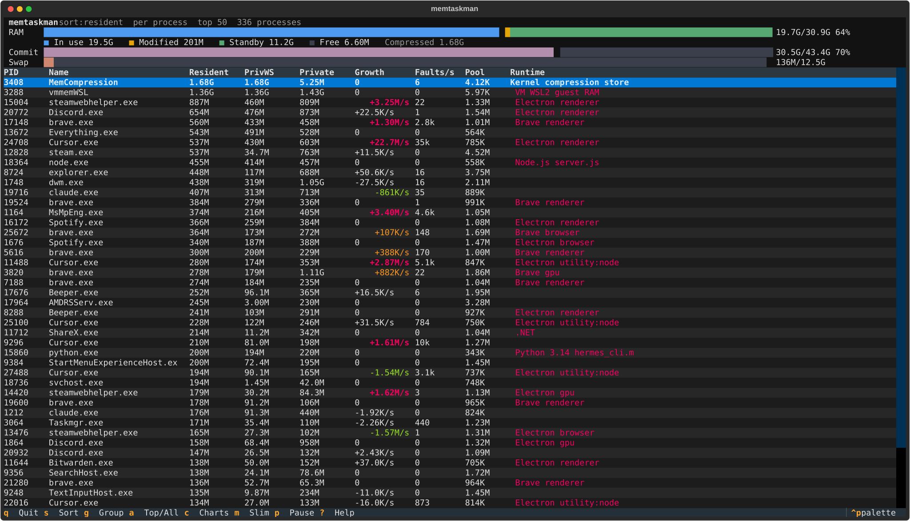
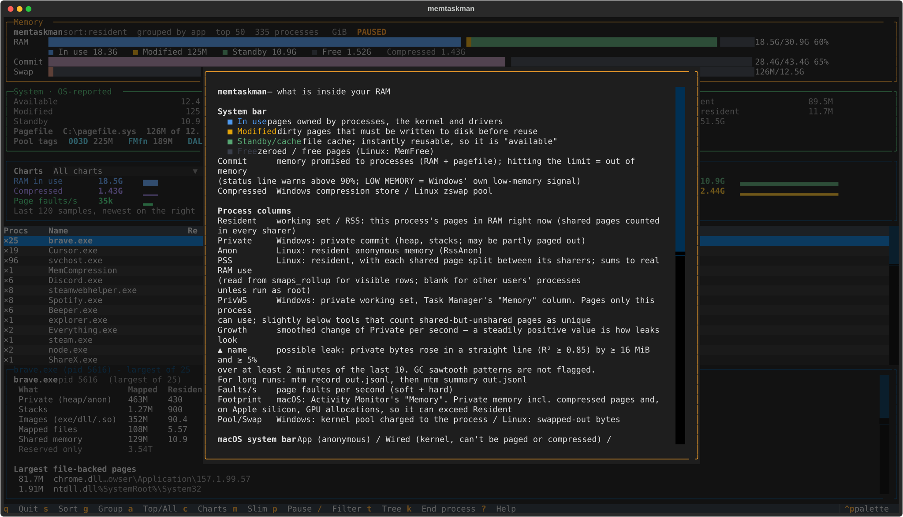

# memtaskman

[](https://github.com/Yogpod/memtaskman/actions/workflows/ci.yml)

An `htop` for what's **inside** your RAM, not just how full it is.

Task Manager tells you Chrome uses 5 GB. memtaskman tells you which of those bytes are
heap, which are DLL code shared with every other process, which are memory-mapped files
(fonts, caches, model weights), which are thread stacks, and how much is actually resident
versus merely committed. It also shows *where* the rest of your RAM is: standby cache,
modified pages, the compression store, kernel pools and commit charge.

Inspired by [gputaskman](https://github.com/shanselman/gputaskman), which does the same for VRAM.

> Early, experimental software. Windows is the primary target, Linux is supported (tested on Ubuntu under WSL2).
> macOS support (footprint, compression, memory pressure, and a vmmap-style inspector) is new and
> **not yet validated on a real Mac**; it's checked by CI on Apple silicon runners.



<details>
<summary>More screenshots: grouped by app, slim mode, help</summary>

**Grouped by app** (`g`): every process of the same executable summed into one row.



**Slim mode** (`m`): just the bars and the table.



**Help** (`?`): what every counter means.



</details>

Screenshots are captured with `tools/capture_screenshots.py` in privacy mode: no command lines, and
home directories are shown as `~`.

## What you get

- **System bar**: RAM split into *In use / Modified / Standby / Free* (Windows) or
  *In use / Cache / Free* (Linux), plus commit charge and swap/pagefile bars.
- **Eight history charts**: RAM in use, commit, standby/cache, compressed, swap,
  kernel pools, page faults/s and hard faults/s. `c` cycles to a single large chart.
- **System panel**: available memory, modified/dirty, standby/page cache, kernel paged
  and nonpaged pools (slab on Linux), compression store, driver-resident bytes, commit peak.
- **Process table**: resident (working set / RSS), private commit (Windows) or anonymous
  resident (Linux), a smoothed **growth rate** (a steadily positive number is what a leak
  looks like), page faults/s, kernel pool or swap, and the identified **runtime**.
  On Windows a **PrivWS** column shows the private working set, which is Task Manager's "Memory"
  number, for every process from a single PDH query.
  On Linux there is also a **PSS** column (resident memory with shared pages split fairly
  between the processes sharing them, so the column sums to real RAM use), read from
  `smaps_rollup` for the visible rows only. Other users' processes show `-` unless you run as root.
- **Leak watch**: rows marked **▲** have private bytes that rose in a straight line (least-squares
  R² ≥ 0.85, at least 16 MiB and 5%) over at least 2 of the last 10 minutes. Garbage-collector
  sawtooth patterns aren't flagged. For hours-long hunts, `mtm record` then `mtm summary`.
- **What's inside `vmmemWSL`** (Windows): select the `vmmemWSL` row (or `mtm inspect <pid>`) to see
  the WSL2 guest's own view: used, page cache, tmpfs and free, versus what Windows holds for
  the VM, plus `.wslconfig` limit and reclaim hints. It's read on demand and only when a distro
  is already running, because polling would keep WSL from shutting down when idle. Disable it
  with `--no-host`. Inside WSL, the Linux view notes that its RAM is really `vmmemWSL` on the host.
- **macOS**: an Activity Monitor-style RAM bar (App / Wired / Compressed / Cached files / Free),
  memory pressure level (normal / warn / critical), a **Footprint** column (Activity Monitor's
  "Memory", which includes compressed memory and, on Apple silicon, GPU memory), and an inspector
  that walks regions like `vmmap`. It splits malloc heaps, stacks, **Graphics / GPU** (IOKit,
  IOSurface, IOAccelerator, CoreAnimation), **JIT / JavaScript**, dylibs plus the dyld shared
  cache (counted once), and mapped files.
- **AI models in RAM**: memory-mapped GGUF files (llama.cpp, Ollama, LM Studio) are named from
  their header, e.g. `Qwen3 14B Q4_K_M: 3.9G of 8.6G resident (45%)`. Only the header is read,
  never the weights. Inspecting an Ollama process asks its local API (`GET /api/ps`, localhost
  only, 0.5 s timeout) how each loaded model is split between RAM and VRAM.
- **Group by app** (`g`): every `chrome.exe`/`brave.exe`/`Discord.exe` summed into one row.
- **Group by cgroup** (`g` again, Linux): one row per systemd service, container, pod or login
  session, sized by the kernel's own cgroup accounting (`memory.current`, so shared pages are
  counted once), with anon / file / shmem / kernel breakdown, `memory.max` limits, OOM kills and
  per-cgroup memory pressure in the inspector.
- **Linux extras**: OOM kills since boot (status line flags new ones) and, in the inspector, each
  process's OOM score and its place in the OOM killer's queue; zram and zswap under Compressed;
  KSM savings and hugepage reservations; the largest kernel slab caches (root only); and RAM no
  process owns: tmpfs mounts, SysV shared memory, and `/dev/shm` / memfd files with the
  processes holding them.
- **Memory pressure** (Linux PSI): the percentage of time tasks stalled waiting for memory,
  shown in the status line and as a chart. It's a better out-of-memory signal than "% used".
- **Kernel pool by tag** (Windows, like `poolmon`): the largest paged / nonpaged pool tags and how
  fast each grows, plus any small tag growing fast. A steadily growing nonpaged tag is how a
  driver leak looks. Works without admin. Map tags to drivers with Microsoft's `pooltag.txt`.
- **Pagefiles and low memory** (Windows): size, use and peak per pagefile; the status line flags
  Windows' own low-memory signal and commit charge above 90% of the limit.
- **Standby by priority** (Windows): the standby cache split into reserve, normal and core,
  in the order Windows reuses them.
- **Inspector** for the selected process, built from a page-level walk of its address space:

  | Category            | Meaning                                                           |
  |---------------------|-------------------------------------------------------------------|
  | Private (heap/anon) | heaps, GC heaps, JIT code, anonymous mmap — memory only it owns   |
  | Stacks              | thread stacks                                                     |
  | Images              | exe / DLL / .so pages, mostly shared with other processes         |
  | Mapped files        | memory-mapped files: font caches, databases, mmap'd model weights |
  | Shared memory       | pagefile-backed sections, `/dev/shm`, memfd                       |

  For each: bytes committed/mapped, bytes resident, and how many resident bytes are shared,
  plus the largest file-backed mappings and the address space that is only reserved.

### Runtime identification

Runtimes are recognised from loaded modules, the executable and the command line, and every
claim is tagged with how strong the evidence is: **measured** (OS counter), **derived**
(computed by memtaskman), **identified** (from loaded modules), **hint** (a configured limit
such as `-Xmx` or `--max-old-space-size`, which is not usage).

Recognised: Chromium browsers and their process types (Chrome, Edge, Brave, Opera, Vivaldi,
WebView2, Electron apps: renderer / gpu / utility:network …), Firefox, Java, .NET and
.NET Framework (including chocolatey shims), Node.js / Bun / Deno, CPython (version from
the DLL, PyTorch detection), local LLM servers (Ollama, llama.cpp, LM Studio, vLLM,
Foundry Local), databases (SQL Server, PostgreSQL, MySQL, Redis, MongoDB …), hypervisor
hosts (`vmmem`/`vmmemWSL`, QEMU, VMware, VirtualBox) and the Windows compression store.

## Install & run

**From PyPI** (Python 3.11+):

```bash
uv tool install memtaskman    # or: pipx install memtaskman
mtm                           # or: memtaskman
```

**Scoop** (Windows):

```powershell
scoop bucket add memtaskman https://github.com/Yogpod/memtaskman
scoop install memtaskman
```

**Portable, no Python needed:** download the zip (Windows x64 / ARM64) or tar.gz (Linux x64 /
ARM64, glibc 2.35+) from the [latest release](https://github.com/Yogpod/memtaskman/releases/latest),
extract it, and run `mtm` inside. Keep the `_internal` folder next to it. Each archive has a
`.sha256` checksum; the builds are unsigned, so Windows SmartScreen may ask once.

**From a clone:**

```bash
uv run mtm                # or: uv tool install .
```

The layout adapts to the terminal: below 150 columns the system panel and inspector move under
the table, less important columns are dropped as space runs out, and charts are hidden below 36
rows. It's usable down to 80×24; the full view wants about 190 columns.

### Configuration

Defaults can live in a TOML file; command-line flags always win.

| OS | Location |
|---|---|
| Windows | `%APPDATA%\memtaskman\config.toml` |
| Linux | `~/.config/memtaskman/config.toml` (or `$XDG_CONFIG_HOME`) |
| macOS | `~/Library/Application Support/memtaskman/config.toml` |

```toml
sort = "growth"      # resident | pss | uss | private | growth | faults | name | pid
group = "none"       # none | app | cgroup
tree = true
top = 40
units = "decimal"    # binary (GiB) | decimal (GB)
interval = 2.0
```

`mtm --print-config` prints every setting with its effective value and whether it came from a
flag, the file or the default, as TOML you can paste into the file. `MEMTASKMAN_CONFIG` points
to a different file. Unknown keys and bad values are reported and ignored, never fatal.

### Permissions

memtaskman works without admin rights. Other users' and services' processes still appear in the
table, but some of their values show `-`, and the inspector explains why. For the full picture:

- **Windows:** run from an elevated terminal. Protected processes (anti-malware, `System`) stay
  partly hidden even then.
- **Linux:** run with `sudo` for other users' PSS, `smaps` and `/proc/slabinfo`.
- **macOS:** run with `sudo` for other users' footprint and region walk. System Integrity
  Protection still blocks some Apple system processes even as root; memtaskman never asks for
  debugger permissions (`task_for_pid`).

## Keys

| Key        | Action                                   |
|------------|------------------------------------------|
| ↑ / ↓      | select a process and inspect it          |
| `k`        | end the selected process: type its name to confirm; polite first, `k` again to force (disabled by `--read-only`) |
| `t`        | process tree (Enter collapses / expands; collapsed rows show subtree totals) |
| `u`        | binary (GiB) / decimal (GB) units |
| `/`        | filter by name, runtime or PID (Enter keeps it, Esc clears) |
| `s`        | cycle sort (or click any column header; click again to reverse) |
| `g`        | cycle grouping: per process, by app, by cgroup (Linux) |
| `a`        | top 50 / all processes                   |
| `c`        | cycle charts (all, or one metric)        |
| `m`        | slim mode (table only)                   |
| `p`        | pause / resume                           |
| `?`        | explanations of every counter            |
| `q`        | quit                                     |

## Command line

```text
mtm                         interactive TUI
mtm -i 2                    sample every 2 seconds
mtm --once [--top N|--all]  print a text report and exit
mtm --json [--top N|--all]  print a JSON snapshot and exit
mtm --no-system             skip system-wide counters
mtm --sort growth --tree     initial sort / view (also --group app|cgroup, --slim)
mtm --print-config          effective settings (config file + flags) as TOML
mtm --read-only             disable ending processes (also read_only = true in the config)
mtm --units decimal         1G = 1 GB (10⁹ bytes) instead of 1 GiB; JSON always stays in bytes
mtm --once --filter brave   only processes matching a name, runtime or PID (also --json, record)
mtm --no-host               don't read the WSL2 guest's memory when inspecting vmmemWSL
mtm inspect PID [--json]    address-space breakdown of one process
mtm record out.jsonl [-i 5] [-n COUNT] [--duration 2h] [--all] [--compact]   append snapshots (JSON Lines)
mtm summary out.jsonl [--top N] [--json]   steadily growing processes in a recording (leak finder)
mtm diff a.json b.json [--json] [--threshold 16m] [--by-name]   what grew, restarted, appeared or went away
```

Recording size: about 19 KB per snapshot with the default `--top 50` (~14 MB/hour at the default
5 s interval) and about 120 KB with `--all` (~85 MB/hour). An interrupted recording can be
appended to; a half-written last line is skipped when reading. `--compact` keeps only the fields
`diff` and `summary` use: about 8 KB per snapshot (~6 MB/hour), or about 48 KB with `--all`.

`diff` pairs processes by PID *and* start time (a reused PID is a different process), pairs
a unique name that came back under a new PID as `restarted`, and hides changes under 16 MiB
in text output (`--json` keeps everything).

Tip: take both snapshots with `--all` before using `diff`, otherwise processes outside the
top N can only be reported as `not listed`.

## How it measures

| Source | Platform | Used for |
|--------|----------|----------|
| PDH `\Memory\*` counters | Windows | standby (3 priorities), modified, free+zero, cache, pools, fault rates |
| PDH `\Process V2(*)\Working Set - Private` | Windows | private working set for every process (falls back to `\Process(*)`) |
| `GetPerformanceInfo` | Windows | commit charge / limit / peak |
| `GetProcessMemoryInfo` (via psutil) | Windows | working set, private commit, pools, fault counts |
| `VirtualQueryEx` | Windows | every region: committed vs reserved, image / mapped / private, stacks (guard pages) |
| `GetMappedFileName` | Windows | which file backs each image/mapped region |
| `QueryWorkingSet` | Windows | every resident page and its shared bit, attributed back to regions |
| `EnumProcessModulesEx` | Windows | loaded DLLs for runtime identification |
| `host_statistics64(HOST_VM_INFO64)` | macOS | app / wired / compressed / cached / free pages, faults, page-ins |
| `sysctl` `vm.pagesize`, `kern.memorystatus_vm_pressure_level` | macOS | page size (16 KB on Apple silicon), memory pressure |
| `proc_pid_rusage(RUSAGE_INFO_V4)` | macOS | physical footprint and lifetime peak per process |
| `proc_pidinfo(PROC_PIDTASKINFO / PROC_PIDREGIONPATHINFO)` | macOS | fault counts; per-region tag, share mode, resident / shared / swapped pages, backing file |
| `/proc/meminfo`, `/proc/vmstat` | Linux | cache, dirty, slab, zswap, commit, fault rates |
| `/proc/<pid>/status`, `stat` | Linux | RssAnon / RssFile / RssShmem, VmSwap, VmHWM, faults |
| `/proc/pressure/memory` | Linux | memory pressure stall information (PSI) |
| `/proc/<pid>/cgroup`, `/sys/fs/cgroup/**/memory.*` | Linux | cgroup membership, `memory.current`, `memory.stat`, limits, events, per-cgroup pressure (v2; v1 basic) |
| `/proc/<pid>/smaps_rollup` | Linux | PSS and USS (private clean + dirty) for visible rows, refreshed every 2 s at most |
| `/proc/<pid>/smaps`, `maps` | Linux | per-mapping Rss / Shared / Swap, loaded libraries |

Nothing reads the *contents* of another process's memory; only metadata about its pages.

Caveats:

- Resident totals in group mode double count pages shared between members (DLLs, shared
  memory). Private totals do not overlap.
- On Windows, *Private* is commit charge: it can exceed the working set when pages are
  paged out or compressed.
- The compression store is reported as the working set of the `MemCompression` process.
- The inspector walk takes ~0.1-1 s for very large processes; it runs in the background and
  refreshes every 5 seconds.
- macOS *Footprint* includes compressed memory and, on Apple silicon, GPU allocations, so it
  can exceed *Resident*. That is intended: it's what Activity Monitor calls Memory.

## Privacy

- memtaskman reads memory **metadata** (sizes, page states, mapped file names), never the
  contents of another process's memory. Model files are read up to their GGUF header only.
- Read-only except for one deliberate action: `k` ends a process, only after you type its name,
  never for critical system processes, and only if the PID still belongs to the same process.
  `--read-only` removes it.
- No telemetry. The only network request is an optional `GET /api/ps` to an Ollama server on
  localhost, made only while you inspect an Ollama process.
- `--json`, `record` and `inspect` output contain process names, command lines, file paths
  (including your home directory) and model names. **Redact before sharing.**
- `--privacy` hides command lines and shows home directories as `~` in the interface, for
  screenshots and screen sharing. Process names stay visible.

## Troubleshooting

| Symptom | Cause and fix |
|---|---|
| Many `-` values for other users' processes | Expected without admin/root; the inspector says why. Run elevated / with `sudo`. |
| Inspector says "access denied" | Same as above; protected Windows processes stay hidden even when elevated. |
| No PSS column values on Linux | PSS is read for visible rows only, every 2 s; other users' rows need `sudo`. |
| Standby/modified missing on Windows | PDH counters disabled or corrupted: `lodctr /r` from an elevated prompt. |
| Memory pressure shows `-` on Linux | Kernel without PSI (`CONFIG_PSI`), or booted with `psi=0`. |
| `vmmemWSL` inspector has no guest view | No distro is running (memtaskman never starts WSL), or `--no-host` was given. |
| Leak marker never appears | It needs at least 2 minutes of steady growth of 16 MiB and 5%; use `record` + `summary` for slow leaks. |
| Layout cramped or columns missing | Columns are dropped as width shrinks; the full view wants ~190 columns, or press `m` for slim mode. |
| Ollama model split not shown | Ollama's API isn't on localhost (`OLLAMA_HOST`), or the server isn't running. |

## Development

```bash
uv sync
uv run python -m unittest discover -s tests -v   # hardware-independent unit tests
uv run python tools/smoke.py                      # live check: counters, inspector, TUI, every CLI command
uv build
uv run --with pyinstaller python tools/build_portable.py   # portable bundle for this OS/CPU
```

CI (`.github/workflows/ci.yml`) runs the unit tests and the smoke test on Windows, Linux and
macOS with Python 3.11 and 3.14, then builds the wheel and runs it. To release, bump `version`
in `pyproject.toml`, then push a matching tag (`git tag v0.2.0 && git push main v0.2.0`). The release
workflow tests, builds, attaches the sdist and wheel to a GitHub release and publishes them
to PyPI.

Layout:

```
src/memtaskman/
  app.py        Textual TUI
  cli.py        argument parsing, --once / --json / inspect / record / summary / diff
  collector.py  sampling, rates, leak series, runtime cache, cgroups, unavailable reasons
  win32.py      Windows ctypes: PDH, GetPerformanceInfo, VirtualQueryEx, QueryWorkingSet, modules
  linux.py      /proc and cgroup parsers (pure) and readers
  macos.py      macOS ctypes: host_statistics64, proc_pid_rusage, region walk
  wslhost.py    the WSL2 guest's view of vmmemWSL, on demand
  models.py     GGUF header parser, Ollama /api/ps
  runtime.py    runtime identification from modules + command line (pure)
  leaks.py      trend fitting, leak rule, recording summary (pure)
  diff.py       snapshot comparison (pure)
  model.py      dataclasses shared by everything
  report.py     text / JSON output
  fmt.py        byte & rate formatting, redaction
tests/          hardware-independent unit tests
tools/          smoke.py (live end-to-end check, used by CI), capture_screenshots.py

See AGENTS.md for the evidence rules every change must follow, and CONTRIBUTING.md.
```

## License

MIT
